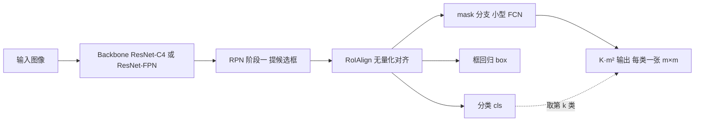

# Mask R-CNN：给 Faster R-CNN 加一条掩码分支，顺便把"对齐"这件事抠了出来

## 一句话总结

**Mask R-CNN = Faster R-CNN + 一条与分类/回归并行的 mask 分支**（每个 RoI 输出 K·m² 的二值掩码），结构上简单到"加个输出头"就完事（第 3 页）。但真正让它 work 的不是这条分支本身，而是两个被作者抠出来的细节：**RoIAlign**（去掉 RoIPool 的两次坐标量化，改用双线性插值取点）和**掩码与分类解耦**（逐类 sigmoid + 二值交叉熵，而非 FCN 惯用的 softmax 多分类），外加用 **FCN 而非 fc 层**预测掩码。没有花活，单模型全面超过 COCO 2015/2016 两届分割冠军，5 fps，还顺手把关键点检测也做了（63.1 AP^kp）。

## 核心问题

实例分割要求**既检测每个物体、又逐像素分割每一个实例**——它同时是目标检测（按框分类定位）与语义分割（逐像素分类）的并集，但比两者都难，因为**同类实例彼此重叠**是它独有的困难（第 1 页、第 9 页）。

论文把此前路线分成三拨（第 2 页）：

| 路线 | 代表 | 做法 | 硬伤 |
|---|---|---|---|
| **分割优先**（segment-first） | DeepMask / SharpMask、MNC | 先提 segment proposals，再识别分类 | 慢、精度差；MNC 还是多级级联，流程复杂 |
| **像素优先**（bottom-up） | InstanceCut、DWT、SGN | 先语义分割，再把同类像素"切"成实例 | 依赖分割质量，实例切分靠后处理 |
| **位置敏感通道** | FCIS | 全卷积同时预测 class/box/mask | 重叠实例上**系统性伪影**（Fig.6，第 6 页） |

Mask R-CNN 走的是它们的反面——**instance-first**：先用 RoI 把实例隔离出来，再在实例内部做像素级预测（第 3 页）。作者明确说"期待未来两种策略的结合"（第 3 页）。

**那个被忽略的坑**：Faster R-CNN **从设计上就不是为"输入输出像素对齐"服务的**。RoIPool 在提特征时做了两次量化（RoI 坐标舍入到特征图网格、划分 bin 时再舍入一次）。分类对几个像素的平移不敏感，所以十几年没人觉得有问题；但**掩码是逐像素任务，这些错位直接吃掉精度**（第 1 页、第 3 页）。

## 关键方法

### 1. 整体结构：两阶段 + 第三条并行分支（第 3 页，Fig.1 第 1 页）

- **阶段一**：RPN，与 Faster R-CNN **完全相同**。
- **阶段二**：Fast R-CNN 式的分类 + 框回归，**并行**再加一条 mask 分支。
- mask 分支对每个 RoI 输出 $K m^2$ 维；推理时只取分类分支判定的第 k 张，rescale 到 RoI 尺寸，0.5 阈值二值化（第 5 页）。

### 2. 损失：逐类二值，不搞类别竞争（第 3 页）

$L = L_{cls} + L_{box} + L_{mask}$

- $L_{cls}$、$L_{box}$ 与 Fast R-CNN 完全一致。
- $L_{mask}$ = **逐像素 sigmoid + 平均二值交叉熵**，且**只在第 k 个通道上定义**（k 为真值类别），其他通道不贡献 loss。
- 只在**正样本 RoI** 上计算；mask 目标 = RoI 与 GT mask 的**交集**（第 4 页）。

**为什么这一点最关键**：FCN 做语义分割的惯例是 per-pixel softmax + 多项交叉熵，类别之间**相互竞争**。但一旦检测器已经把实例整体分好类，掩码就退化成"这个像素是不是这个东西"的二值问题，竞争不但没意义，还有害。消融里换成 softmax 直接掉 **5.5 AP**（30.3 → 24.8，Table 2b，第 6 页）。

反过来的旁证：**类别无关掩码几乎不掉点**（所有类共用一张 m×m，29.7 vs 30.3 AP，ResNet-50-C4，第 6 页）——说明分类与分割确实被解耦得很干净。

### 3. RoIAlign：全文的技术内核（第 3 页，Fig.3 第 3 页）

**RoIPool 的两次量化**：坐标先向下取整 $x$ → ⌊$x/16$⌋（16 为特征图步长），分 bin 时再取整一次。

**RoIAlign 的三步改动**：
1. **不做任何量化**（用 $x/16$ 而不是 ⌊$x/16$⌋）；
2. 每个 bin 内取 **4 个规则采样点**，用**双线性插值**算出特征值；
3. 聚合（max 或 average——实验证明两者几乎无差，默认 average）。

作者的结论很硬："**只要不量化，采样点的具体位置和采样数量都不敏感**"（第 3 页）。

**与 RoIWarp 的对照最能说明问题**（Table 2c，第 6 页）：RoIWarp（MNC）也用了双线性重采样，但它**仍对 RoI 做量化**，结果 27.2 AP，与 RoIPool 的 26.9 几乎一样。→ **双线性插值本身不是关键，"不对齐"才是罪魁**。

### 4. 网络结构（第 3–4 页，Fig.4 第 4 页）

命名规则：`backbone-深度-特征层`。

| Backbone | 特征来源 | Head |
|---|---|---|
| ResNet-50-C4 | 第 4 阶段输出（stride 16） | 含 res5（9 层），**计算重**；C4 版推理 ~400 ms |
| ResNet-FPN | 特征金字塔，按尺度取层级 | 已含 res5，head 更轻，**又快又准** |

掩码头（要复现就照这个抄）：
- **C4 版**：RoI 经 res5（首层改为 7×7/stride1）→ 14×14×256 → deconv → 28×28×256 → 1×1 conv → 28×28×80
- **FPN 版**：4 个连续 3×3 conv（14×14×256）→ deconv 2× → 28×28×256 → 1×1 conv → 28×28×80

所有 conv 为 3×3（输出层 1×1），deconv 为 2×2/stride2，隐藏层 ReLU。

### 5. 实现细节（第 4 页，可直接抄）

**训练**
- 正样本：与 GT 框 IoU ≥ 0.5；其余为负
- 图像短边缩放到 800
- 每 GPU 2 张图；每图采样 N 个 RoI，**正负比 1:3**；N = 64（C4）/ 512（FPN）
- 8 GPU × 160k 迭代，lr 0.02（120k 时 ÷10），weight decay 1e-4，momentum 0.9
- RPN anchor：5 尺度 × 3 长宽比
- ResNeXt 用 1 图/GPU，lr 0.01；RPN 与 Mask R-CNN 默认**不共享**特征（为便于消融）

**推理**
- proposal 数：300（C4）/ 1000（FPN）→ 框回归 → NMS → **只对 top-100 框跑掩码分支**
- 作者说这与训练的并行计算不同，但"**更快也更准**（用了更少、更准的 RoI）"（第 4 页）——一个反直觉但非常实用的工程细节
- 掩码分支开销约为 Faster R-CNN 的 **~20%**（第 5 页）

### 6. 通用性：关键点当成 one-hot 掩码（第 5 节，第 7–8 页）

把每个 keypoint 建模成一张 **one-hot mask**（只有一个像素是前景），其余照搬：
- K 个关键点 → K 张掩码，彼此独立
- 训练目标是 $m^2$ 路 softmax（逼单点响应）
- head：8 个 3×3/512-d conv → deconv + 2× 上采样 → **56×56**（比掩码分辨率更高，因为定位要求更细）

## 实验与结论

### COCO 实例分割（Table 1，第 5 页）

| 方法 | backbone | AP | AP50 | AP75 |
|---|---|---|---|---|
| MNC（COCO'15 冠军） | ResNet-101-C4 | 24.6 | 44.3 | 24.8 |
| FCIS+++（COCO'16 冠军，+OHEM+多尺度+翻转） | R-101-C5-dilated | 33.6 | 54.5 | – |
| **Mask R-CNN** | ResNet-101-C4 | 33.1 | 54.9 | 34.8 |
| **Mask R-CNN** | ResNet-101-FPN | **35.7** | 58.0 | 37.8 |
| **Mask R-CNN** | ResNeXt-101-FPN | **37.1** | 60.0 | 39.4 |

**无任何 bells and whistles**，单模型就压过堆了一堆技巧的 FCIS+++。5 fps（~200 ms/帧），COCO 训练 1–2 天（8 卡）。

### 检测：白送的提升（Table 3，第 7 页）

| backbone | AP^bb |
|---|---|
| Faster R-CNN w FPN（R-101-FPN） | 36.2 |
| Faster R-CNN **+ RoIAlign**（R-101-FPN） | 37.3 |
| **Mask R-CNN**（R-101-FPN） | **38.2** |
| **Mask R-CNN**（ResNeXt-101-FPN） | **39.8** |

增益可精确拆解（第 7 页）：**RoIAlign +1.1、多任务训练 +0.9、ResNeXt +1.6**。也就是说加掩码分支当正则还能白赚 0.9 个点——**多任务确实有正收益，但它只占 0.9，不是主角**。

另一个数字：掩码 AP 与框 AP 只差 **2.7 点**（37.1 vs 39.8），作者认为这说明**检测与实例分割的鸿沟已被大幅填平**（第 7 页）。

### 关键点（Table 4，第 8 页）

| 方法 | AP^kp |
|---|---|
| CMU-Pose+++（COCO'16 冠军，多尺度 + CPM 后处理 + 检测器过滤） | 61.8 |
| Mask R-CNN, keypoint-only | 62.7 |
| **Mask R-CNN, keypoint & mask** | **63.1** |

**多任务消融（Table 5，第 8 页）**：加掩码分支会**同时**提升 box/mask/keypoint；但加关键点分支会**略微拉低** box/mask AP——即"关键点从多任务中受益，但不反过来帮别人"。

**RoIAlign 对关键点更关键**：即使在 stride 更细的 FPN 上，仍带来 **+4.4 AP^kp**（Table 6，第 6/8 页），因为关键点对定位精度更敏感。

### Cityscapes（第 9 页）

- 只用 fine 标注：test **26.2 AP**，比此前最好（DIN 20.0）相对提升 **>30%**，比"仅用 fine 数据"的最好结果（17.4）提升约 **50%**
- 用 COCO 预训练初始化：**32.0 AP**（+~6 点）→ 该数据集上的方法差异很大程度是**低样本学习能力**的差异
- **同类重叠是核心难点**：person/car 平均每图 6 人 / 9 车，Mask R-CNN 相对提升 ~40% / ~20%
- val/test 存在明显偏置，集中在样本极少的 truck/bus/train（200–500 训练样本），COCO 预训练能缓解但**消不掉**

### 消融速查（Table 2，第 5–6 页）

| 表 | 变量 | 结论 | 数字 |
|---|---|---|---|
| 2a | Backbone | 越深越好；FPN > C4；ResNeXt > ResNet | R-50-C4 30.3 → R-101-FPN 35.4 |
| 2b | softmax vs sigmoid | **解耦分类与掩码极其重要** | 24.8 → 30.3（**+5.5**） |
| 2c | RoIPool / RoIWarp / RoIAlign（stride 16） | **"不对齐"才是罪魁**，双线性本身没用 | 26.9 / 27.2 / 30.3（+3.4） |
| 2d | RoIAlign（stride 32, C5） | 步长越大，错位越致命 | 23.6 → 30.9（**+7.3**，AP75 **+10.5**） |
| 2e | MLP vs FCN | 保留空间结构有用 | 31.5 → 33.6（**+2.1**） |

**2d 是最有说服力的一行**：用了 RoIAlign 后，stride-32 的 C5 特征（30.9）反而**比 stride-16 的 C4（30.3）更准**。作者称这"基本解决了长期以来的大步长特征难题"（第 6–7 页）。

### 附录：作为"骨架"的上限（Table 8/9，第 10 页）

每个改进都同时提升掩码与框 AP（说明框架泛化性好），累加后：
- 实例分割/检测：**41.8 mask AP / 47.3 box AP**（e2e 训练 + ImageNet-5k 预训练 + 尺度增广 + X-152 + Non-local + 测试时增广）
- 关键点：**70.4 AP^kp**（含 data distillation，用上了 12 万无标注图）

> **COCO 2017 实例分割竞赛前三名全部基于 Mask R-CNN 的扩展**（第 10 页）。这句话比任何消融都更能说明它作为"基座"的地位。

### 局限（作者承认 + 我的判断）

- 设计**未针对速度优化**，更好的速度/精度权衡（改图像尺寸、proposal 数）留待后续（第 7 页）
- C4 变体 head 太重（~400 ms），**实践中不推荐**（第 7 页）
- 关键点分支对 box/mask 有轻微负迁移（第 8 页）
- Cityscapes 上 truck/bus/train 的域偏移**未解**（第 9 页）
- 我的判断：它是"**把难题挪到已解决的位置**"的典型胜利——实例切分交给 RPN+框，掩码只回答"这个像素属不属于这个物体"，所以并没有真正解决"同类重叠"这个本质困难，只是绕开了它（FCIS 试图正面刚，结果在重叠处系统性出错，Fig.6 第 6 页）

## 我的疑问

- [ ] RoIAlign 的"4 个采样点 + 双线性"在**极大步长**（如 stride 64 的轻量主干）下还够用吗？论文只测到 stride 32，且已经在说"采样位置不敏感"，这个不敏感性的**边界在哪**？
- [ ] 类别无关掩码只掉 0.6 AP（29.7 vs 30.3），那"逐类掩码"到底在什么场景下才真正必要？细粒度/相似类别上会不会差距放大？
- [ ] 推理时掩码只跑 top-100 框带来了精度提升，但这个 100 是**跟着 COCO 的平均目标数**定的。密集场景（如 Cityscapes 的 6 人 9 车）是否该提高？论文没做这个消融
- [ ] 关键点分支对 box/mask 的负迁移是"容量竞争"还是"梯度冲突"？论文只说现象没给解释
- [ ] 如果今天重做，把 RoIAlign 换成**可变形卷积式的自适应采样点**，理论上限还有多少？（RoIAlign 的意义是把采样位置从"量化后固定"变成"连续可微"，下一步自然是让位置也可学）

## 关键摘录

> "We present a conceptually simple, flexible, and general framework for object instance segmentation."（第 1 页）

> "In principle Mask R-CNN is an intuitive extension of Faster R-CNN, yet constructing the mask branch properly is critical for good results. Most importantly, Faster R-CNN was not designed for pixel-to-pixel alignment between network inputs and outputs."（第 1–2 页）

> "Second, we found it essential to decouple mask and class prediction: we predict a binary mask for each class independently, without competition among classes, and rely on the network's RoI classification branch to predict the category."（第 2 页）

> "This pixel-to-pixel behavior requires our RoI features, which themselves are small feature maps, to be well aligned to faithfully preserve the explicit per-pixel spatial correspondence."（第 3 页）

> "We use bilinear interpolation [22] to compute the exact values of the input features at four regularly sampled locations in each RoI bin, and aggregate the result (using max or average) … We note that the results are not sensitive to the exact sampling locations, or how many points are sampled, as long as no quantization is performed."（第 3 页）

> "So even though RoIWarp also adopts bilinear resampling motivated by [22], it performs on par with RoIPool as shown by experiments (more details in Table 2c), demonstrating the crucial role of alignment."（第 3 页）

> "The mask branch is then applied to the highest scoring 100 detection boxes. Although this differs from the parallel computation used in training, it speeds up inference and improves accuracy (due to the use of fewer, more accurate RoIs)."（第 4 页）

> "RoIAlign largely resolves the long-standing challenge of using large-stride features for detection and segmentation."（第 6–7 页）

> "By viewing each keypoint as a one-hot binary mask, with minimal modification Mask R-CNN can be applied to detect instance-specific poses."（第 2 页）

> "Thanks to its generality and flexibility, Mask R-CNN was used as the framework by the three winning teams in the COCO 2017 instance segmentation competition, which all significantly outperformed the previous state of the art."（第 10 页）

## 相关笔记

- [[Restormer 高效高分辨率图像修复 Transformer]] — 同样在改"从特征图里怎么取东西"：Restormer 把注意力搬到通道维降复杂度；本文的 RoIAlign 是把**取样的坐标**从量化改成连续。可对照理解"结构 vs 取样"两条优化路线
- [[FlashAttention 精确注意力与IO感知]] — 都是"不动语义、只动底层算子"的胜利：FlashAttention 改的是**数据搬哪**，RoIAlign 改的是**像素取哪**
- [[PAGRN 渐进式注意力引导循环网络]] — 同样靠一个干净的反直觉设计拿分：PAGRN 是"注意力乘完不求和、继续传给下一层"，本文是"掩码只在自己那一类上算 loss"
- [[浅层与深层]] — 理解 Table 2a/2d 的背景：C4 与 C5 的差别本质是步长与感受野的权衡，而 RoIAlign 让大步长重新变得可用
- [[SVTR 场景文本识别]] — 同属"把稠密预测任务做成实例级"的思路对照：SVTR 用一个视觉模型直接出序列，本文用 RoI 把稠密预测收敛到实例内部

#论文 #实例分割 #目标检测 #RoIAlign
