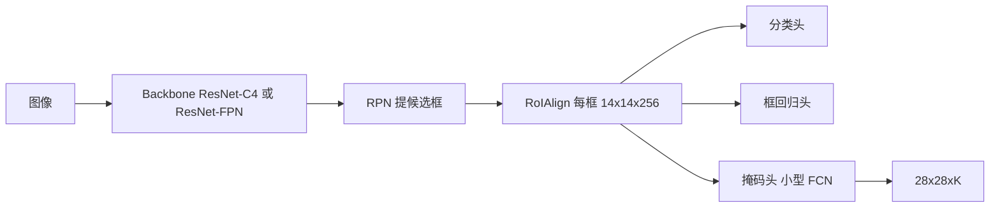

# Mask R-CNN 追问：对齐、解耦与掩码尺寸还原

> 本篇是 [[Mask R-CNN 实例分割的RoIAlign与解耦掩码]] 的**追问补编**：正文笔记讲「是什么」，这里补三个当时没展开的点——**为什么是逐像素 sigmoid、RoIAlign 到底改了什么、掩码怎么从 28×28 回到原图**。页码均指 arXiv:1703.06870v3 的 PDF 页。

## 一句话总结

三个追问其实指向同一条主线：**Mask R-CNN 的分数几乎全部来自「把一个语义问题改写成几何/数值问题，并且做对」**——对齐（几何，去掉取整）、解耦（把 K 类多分类降成二值）、固定分辨率（把尺度变化从掩码任务里剥离）。三件事加起来才让「加一条分支」真的成立。

---

## 追问 1：为什么是「逐像素 sigmoid」，而不是 softmax？

### 字面上它是什么

掩码分支对**每个 RoI** 输出一个 $K×m×m$ 的张量（K 为类别数 80，m=28）。「逐像素 sigmoid」= 对张量里**每一个元素各自**做一次独立二元判定（第 3 页）：

$$\hat{y}_{k,i} = \sigma(z_{k,i}) = \frac{1}{1+e^{-z_{k,i}}}, \quad k=1..K,\ i=1..m^2$$

损失是平均二值交叉熵，且**只在第 k 个通道上算**（k 为该 RoI 的真值类别）（第 3 页）：

$$L_{mask} = -\frac{1}{m^2}\sum_{i=1}^{m^2}\Big[ y_i \log \hat y_{k,i} + (1-y_i)\log(1-\hat y_{k,i}) \Big]$$

配套两个约束：只对**正样本 RoI** 算（第 4 页）；掩码目标 = RoI 与 GT 掩码的**交集**（第 4 页）。

关键点：**K 个通道之间没有任何归一化耦合**。第 1 类通道说「0.9」，第 2 类照样能说「0.8」，各答各的。

### 它的对立面：逐像素 softmax

FCN 做语义分割的标准做法（第 3 页原文点名）是：

$$\hat y_{k,i} = \frac{e^{z_{k,i}}}{\sum_{j=1}^{K} e^{z_{j,i}}}$$

再配多项交叉熵。于是**每个像素上 K 个类别的概率和为 1**，必须互相竞争：一类升高，其余被压低。原文措辞是 masks across classes **compete**，改用 sigmoid 后 they do **not**（第 3 页）。

| | 逐像素 softmax | **逐像素 sigmoid** |
|---|---|---|
| 通道之间 | 竞争（和为 1） | **独立**（各自 0~1） |
| 每像素回答 | 「这是 K 类中的哪一类」 | 「这是不是*这个东西*」（是/否） |
| 监督范围 | 所有通道被归一化牵扯 | **只监督第 k 通道** |
| 能否做类别无关掩码 | 不能 | **能** |

### 为什么「竞争」在这里有害

作者的论证是：**实例类别，框分支已经判过了**（第 3 页）。既然 RoI 整体已定类，掩码再在像素级重做一次分类是多余且有害的。

具体的害处：物体边缘、遮挡处像素证据本就模糊，softmax 强迫网络做**硬性类别分配**，梯度会把概率质量在类间来回推，导致掩码收缩、变软，或把边界让给邻类。sigmoid 只问「这一像素是不是这个人」，模糊处直接给 0.5 就完事，不牵连别类。

原文（第 3 页）：

> "Our definition of L_mask allows the network to generate masks for every class without competition among classes; we rely on the dedicated classification branch to predict the class label used to select the output mask. **This decouples mask and class prediction.**"

### 数字（Table 2b，第 6 页，ResNet-50-C4）

| 掩码监督方式 | AP | AP50 | AP75 |
|---|---|---|---|
| softmax（多类） | 24.8 | 44.1 | 25.1 |
| **sigmoid（逐类二值）** | **30.3** | 51.2 | 31.5 |
| 增益 | **+5.5** | +7.1 | +6.4 |

5.5 点，比本文大多数结构改动（换 backbone、换 head）都大。

### 最容易忽略的一点：推理阶段看不出差别

第 5 页写明：只取第 k 张掩码、resize 到 RoI、0.5 阈值二值化。既然只用一张、还二值化，softmax 的归一化对这张图影响很小。

**所以这 5.5 点完全来自训练动力学**——同样的前向与推理开销，不同的梯度流动方式。这是全文最「零成本」的改动：参数量不变、推理不变，只改损失如何构造。

### 一个反过来的旁证

第 6 页：**类别无关掩码**（所有类共用一张 $m×m$）得 29.7 AP，vs 逐类 30.3，只掉 0.6。如果掩码真依赖类别信息，砍掉类别应当崩掉；几乎不掉，说明**框分支定了类之后，掩码分支的类别信息基本冗余**。

### 注意：同一篇论文里两种归一化并存

- **关键点分支用 softmax**（第 8 页）：$m^2$ 路 softmax，因为一个关键点必须在网格里**恰好落在一个位置**——互斥选择，需要归一化竞争。
- **掩码分支用 sigmoid**：逐像素独立二值判断，不需要互斥。

判据不是「哪个效果更好」，而是「**任务是否天然互斥**」。

---

## 追问 2：RoIAlign 到底改了什么（两次量化 + RoIWarp 控制变量）

### RoIPool 做了什么：两次量化

原文（第 3 页）：「RoIPool 首先将浮点数 RoI 量化到特征图的离散粒度，然后将量化后的 RoI 细分为空间分箱，这些分箱本身也会被量化」。即**两个独立的取整点**：

| 阶段 | 操作 | 精度损失 |
|---|---|---|
| ① RoI 边界投影到特征图 | $x ↦ \text{round}(x/16)$ | 最多 ±0.5 个特征格 = **±8 图像像素**（stride 16） |
| ② RoI 切成 $k×k$ 个 bin | 每个 bin 边界再取整 | 再叠加 ±0.5 格 |
| ③ 每 bin 内 max pool | 只取整数格点 | 无插值 |

**具体数字例子**（stride 16，7×7 分箱）：某 RoI 左边界在图像坐标 $x_1=100$。

- RoIPool：$\text{round}(100/16)=\text{round}(6.25)=6$，对应回图像 $96$——**起点直接偏 4 个像素**。
- 再切 7 份，每份宽 $(x_2-x_1)/7$，每个 bin 边界再取整一次，误差在 bin 之间**不均匀累积**。
- 于是 7×7 特征图每格对应的真实图像区域都略有偏差，**而且每个 RoI 偏的量还不一样**。

### 为什么分类扛得住、掩码扛不住

第 3 页原话：「虽然这可能不会影响分类（分类对小幅平移具有鲁棒性），但会对预测像素级精确掩码产生很大的负面影响。」

两个原因叠加：

1. **任务粒度不同**。分类输出一个向量，几像素平移几乎不改变全局特征；掩码输出 $m×m$ 个逐像素标签，**每个标签都必须与原图位置严格对应**。
2. **误差性质不同**。偏差随 RoI 大小、位置变化，**不是全局恒定平移**，网络学不会统一补偿——相当于每次给特征图加一个未知随机抖动。

作者用词是**错位（misalignment）**，而不是精度损失，这是要害。

### RoIAlign 的三处改动

**① 不量化坐标**（第 3 页）：用 $x/16$ 而不是 $⌊x/16⌋$。RoI 边界、bin 边界全部保留浮点。

**② 双线性插值取四个点**（第 3 页，图 3）：特征图是离散网格、坐标是浮点，**没法直接读**，只能插值。图注强调："No quantization is performed on any coordinates involved in the RoI, its bins, or the sampling points."

**③ 聚合**：max 或 average。第 6 页明说「RoIAlign 对 max/average 敏感度很低，我们后文用 average」。

**容易漏掉的好处**：双线性插值对采样坐标**可微**，梯度能回传到 RoI 坐标本身（附录里提到端到端训练用的是「近似」版本，忽略了关于 RoI 坐标的梯度，第 10 页）。RoIPool 的 $\text{round}()$ 导数为 0，做不到。

### 「不敏感」这句话的含义

> "We note that the results are not sensitive to the exact sampling locations, or how many points are sampled, as long as no quantization is performed."（第 3 页）

- **量化误差是一阶、系统性偏差**——坐标被硬拽到格点，方向固定、幅度可达半格，且不可微。
- **无量化下的采样只是连续重采样**——采样点挪一点，插值结果平滑地变一点，误差是二阶小量。

结论：**采样策略（4 点还是 9 点、取在哪）无所谓，唯一的开关是「量化 / 不量化」**。

### 最关键的一组对照：RoIWarp（控制变量）

第 3–4 页：

> "Unlike RoIAlign, RoIWarp overlooked the alignment issue and was implemented in [10] as quantizing RoI just like RoIPool. So even though RoIWarp also adopts bilinear resampling motivated by [22], it performs on par with RoIPool as shown by experiments (more details in Table 2c), demonstrating the crucial role of alignment."

| 方法 | 双线性插值 | **不做量化** | 结果（表 2c，第 6 页） |
|---|---|---|---|
| RoIPool | ✗ | ✗ | 26.9 |
| RoIWarp | **✓** | ✗ | **27.2**（≈ RoIPool，白忙） |
| RoIAlign (max) | ✓ | **✓** | 30.2 |
| RoIAlign (ave) | ✓ | **✓** | **30.3** |

**双线性不是主角，对齐才是主角。** 这是排除法给出的因果证据，比直接报告涨点更有说服力。

### 全部收益（都在第 6 页）

- **表 2c（stride 16，R-50-C4）**：26.9 → 30.3，**+3.4 AP**；AP75 26.4 → 31.5（**+5.1**，越严格的定位指标涨得越多）
- **表 2d（stride 32，R-50-C5）**：23.6 → 30.9，**+7.3 AP**，AP75 **+10.5**；连框检测都 +5.8
- **反直觉的副产品**（第 6–7 页）：用 RoIAlign 后，stride-32 的 C5（**30.9**）比 stride-16 的 C4（**30.3**）**更准**——说明量化误差随步长线性放大，确实是几何性的
- **FPN 上** +1.5 mask AP（第 7 页）；**关键点**即使在 stride 4 的 FPN 上仍 **+4.4 AP**（表 6，第 8 页）

### 两个常见误解

1. 「RoIAlign 是近似，损失精度换速度」——**反了**。RoIAlign 才是更精确的那个，RoIPool 才是近似（把浮点坐标粗暴截断）。
2. 「它就是双线性版的 RoIPool」——**这正是 RoIWarp 的失败姿势**。关键差别不在插值，而在插值之前**是否先把坐标量化掉**；先取整再插值，信息已经提前丢了。

---

## 追问 3：架构是「主干 + 头」吗？掩码怎么生成、m×m 怎么回到原图？

### 是「主干 + 头」，论文自己就这么切的

第 3–4 页原文：*"we differentiate between: (i) the convolutional backbone architecture used for feature extraction over an entire image, and (ii) the network head for bounding-box recognition ... and mask prediction that is applied separately to each RoI."*



更准确的现代说法是**四段**（Mask R-CNN 只是当年没把 neck 这个词叫出来）：

| 段 | Mask R-CNN 里的对应物 | 作用 |
|---|---|---|
| **Backbone** | ResNet-50/101 的 C4 层 | 图 → 特征图 |
| **Neck** | FPN（自顶向下 + 横向连接） | 多尺度融合（第 4 页） |
| **提议器** | RPN | 出候选框 |
| **Head** | 分类 + 框回归 + mask 三条并行分支 | 逐 RoI 出结果 |

命名规则：$backbone-深度-特征层$，如 ResNet-50-C4、ResNet-101-FPN（第 3 页）。

> 范围提醒：这个范式对 CNN 系检测器（Faster R-CNN / YOLO / RetinaNet）都成立。DETR 系保留了「主干 + 头」的外形，但把中间的 RPN+RoI 换成 **object query + 注意力**，头从「逐 RoI 卷积」变成「逐 query 出掩码」。

### 掩码生成：五步流水线

**① 提 RoI 特征（RoIAlign，第 3 页）**：每个 RoI 被对齐采样成**固定**的 $14×14×256$——与框大小无关，这是后面一切的前提。

**② 掩码头：卷积 + 反卷积上采样（图 4，第 4 页）**

FPN 版本（图 4 右）：

| 层 | 输出 |
|---|---|
| 4 × (3×3 conv, 256ch) | $14×14×256$ |
| deconv 2×2 / stride 2（上采样 2 倍） | $28×28×256$ |
| 1×1 conv（输出层） | **$28×28×K$** |

C4 版本路径略异，终点相同。所有隐层 3×3 conv + ReLU，输出层 1×1，deconv 均 2×2/stride2（图 4 图注，第 4 页）。

**③ 逐像素 sigmoid** → K 张二值掩码（第 3 页）

**④ 只取第 k 张**（k 为分类分支判定类，第 5 页）

**⑤ resize + 二值化**（第 5 页）：

> "The m×m floating-number mask output is then resized to the RoI size, and binarized at a threshold of 0.5."

**完整张量流水线**：

```
图像 800×800
  └─ Backbone → 特征图（stride 16，约 50×50×1024）
       └─ RPN → 约 1000 个候选框
            └─ NMS + 取 top-100（第 4 页）
                 └─ RoIAlign → 每框 14×14×256
                      └─ mask head → 28×28×K   ← 固定尺寸
                           └─ sigmoid → 28×28 概率图（第 k 类）
                                └─ resize → h_RoI × w_RoI   ← 回到该框像素尺寸
                                     └─ >0.5 → 二值
                                          └─ 贴回原图对应位置
```

### 为什么掩码非得固定 m×m

1. **尺度无关**：掩码在 **RoI 的归一化坐标系**里预测，28×28 恒等于「整个框」，不管框是 30×30 还是 400×800。网络只学「形状相对框的分布」。
2. **训练目标好定义**（第 4 页）：掩码目标 = RoI∩GT 掩码，栅格化成 28×28 即可。掩码被定义成「只在框内」，网络永远不预测框外像素。
3. **算力固定且便宜**（第 5 页）：只在 top-100 框上算，开销约为 Faster R-CNN 的 **~20%**。

### 尺寸怎么回原图：两步，别搞反顺序

常见错误是「把 28×28 直接拉到 800×800」。正确是：

1. **resize 到「这个框的尺寸」**（第 5 页）：框为 $w×h$，把 28×28 双线性插值成 $h×w$——在该 RoI 自己的坐标系里还原分辨率。
2. **按框位置贴回全图**：把 $h×w$ 的二值掩码贴到画布 $(x_1,y_1)$ 处。

$$28×28 \xrightarrow{\text{resize}} h_{RoI}×w_{RoI} \xrightarrow{\text{paste}} H×W$$

因为掩码分支从头到尾只在 RoI 内部工作（看的是 RoIAlign 裁出的 14×14，目标是 RoI∩GT），**它根本不知道框外的世界长什么样**，所以只可能输出 RoI 范围内的东西。

> 实现补充（论文未写，Detectron 等实现的标准做法）：多个框的掩码贴同一画布会重叠，通常按**检测置信度从高到低**覆盖，高分框优先。这属于后处理约定。

### 这个设计的代价

- **掩码被框锁死**：掩码 ⊆ 框。框漏掉的部位（遮挡后露出部分、细长物体两端）永远补不回来，**框的质量就是掩码的上限**。
- **分辨率由「RoI 尺寸 / 28」决定**：200×400 的行人，每个掩码像素约对应 7×14 个图像像素，边界天然粗。这也解释了为什么消融里 **AP75 涨得比 AP50 多**——严格 IoU 更考验边界。
- **28×28 是折中不是最优**：后续 PointRend / RefineMask 等正是来补这块（先出粗掩码，再在不确定边界点逐点细分）。
- **K 倍输出相当冗余**：出 80 张只用 1 张；类别无关掩码只掉 0.6 AP（第 6 页），这也为后来「每实例一张掩码」的范式（DETR / Mask2Former）留了路。

---

## 三个追问的共同点

三个问题看似分散，其实都是同一件事的三种形式——**把一个语义问题改写成数值/几何问题，并且把数值细节做对**：

| 追问 | 被改写的问题 | 做对的关键 |
|---|---|---|
| RoIAlign | 「特征在哪里」由语义决定 → 由**坐标**决定 | 全程不取整（几何精度） |
| sigmoid | 「像素属于哪一类」→「像素是不是它」 | 去掉类间归一化（解耦梯度） |
| 28×28 固定 | 「掩码多大」→ 「归一化坐标系里的形状」 | 把尺度变化整体剥离 |

它们的共同点还有一个：**改动都极小，收益都很大**（一行取整、一个激活函数、一个固定分辨率）。这也解释了这篇论文为什么能成为基座——它改的都是「别人以为不需要改」的地方。

## 关键摘录

> "This decouples mask and class prediction."（第 3 页）

> "In that case, masks across classes compete; in our case, with a per-pixel sigmoid and a binary loss, they do not."（第 3 页）

> "We note that the results are not sensitive to the exact sampling locations, or how many points are sampled, as long as no quantization is performed."（第 3 页）

> "So even though RoIWarp also adopts bilinear resampling motivated by [22], it performs on par with RoIPool as shown by experiments (more details in Table 2c), demonstrating the crucial role of alignment."（第 3–4 页）

> "The m×m floating-number mask output is then resized to the RoI size, and binarized at a threshold of 0.5."（第 5 页）

> "We note that since we only compute masks on the top 100 detection boxes, Mask R-CNN adds a small overhead to its Faster R-CNN counterpart (e.g., ~20% on typical models)."（第 5 页）

## 相关笔记

- [[Mask R-CNN 实例分割的RoIAlign与解耦掩码]] — 本文的正文精读（结构、实验、消融全表）
- [[FlashAttention 精确注意力与IO感知]] — 同样是「不动语义、只动底层算子」：FlashAttention 改数据搬哪，RoIAlign 改像素取哪
- [[Restormer 高效高分辨率图像修复 Transformer]] — 都在处理「特征图怎么被读出来」：一个换注意力维度，一个改采样坐标
- [[浅层与深层]] — 理解 stride 16 / stride 32 的差别本质是步长与感受野的权衡；RoIAlign 让大步长重新可用

#论文 #实例分割 #RoIAlign #掩码生成
